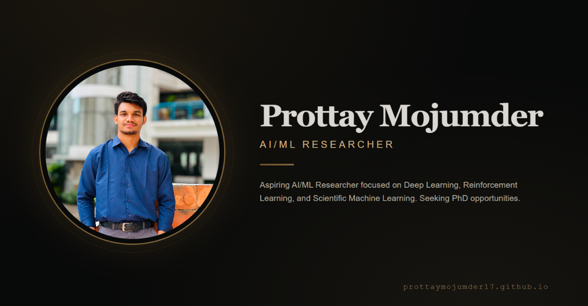

<div align="center">

# 🎓 Prottay Mojumder — Academic Portfolio

**Aspiring AI/ML Researcher · Deep Learning · Reinforcement Learning · Scientific Machine Learning**

[](https://prottaymojumder17.github.io/portfolio/)
[](https://github.com/prottaymojumder17)
[](https://www.linkedin.com/in/prottay-mojumder-154296377/)
[](https://scholar.google.com/)

<br>



<br>

**A premium academic portfolio built with vanilla HTML, CSS, and JavaScript.**

**Oxford Blue theme · Deep Navy + Warm Amber + Ivory · Doctoral Thesis Aesthetic**

</div>

---

## 📖 About

This repository contains the source code for my **academic portfolio website** — designed specifically for a **research-focused career** in **Artificial Intelligence and Machine Learning**.

The site showcases:
- 🎯 Research interests (Deep Learning, Reinforcement Learning, ML for Epidemics, Scientific ML)
- 📚 Publications with BibTeX copy functionality
- 🎓 Academic journey (BSc Software Engineering at Daffodil International University)
- 🏆 Awards & honors
- 👨‍🏫 Teaching & mentoring experience
- 🔬 Research projects & coursework

---

## ✨ Features

| Feature | Description |
|---|---|
| **Oxford Blue Theme** | Deep navy + warm amber + ivory · premium academic aesthetic |
| **Roman Numerals** | Section titles with `I. About`, `II. Research`, etc. |
| **Drop Cap** | Editorial drop cap on the first paragraph |
| **Pull Quote** | Highlighted quote in the About section |
| **BibTeX Copy** | One-click citation copy for each publication |
| **Paper Type Badges** | Journal / Conference / Preprint indicators |
| **Timeline Progress** | Animated progress line in experience/education timelines |
| **Mouse-Follow Glow** | Interactive radial glow on cards |
| **Command Palette** | `Ctrl + K` for quick navigation |
| **Dark Academic Aesthetic** | Paper grain texture, custom scrollbar, ornamental dividers |
| **Responsive Design** | Full mobile support with hamburger menu |
| **JSON-Based Content** | Easy to update — no code changes needed |
| **SEO Optimized** | Open Graph, Twitter Cards, JSON-LD structured data |
| **Google Scholar Meta** | Academic indexing ready |
| **PWA Ready** | Installable as a mobile app |
| **404 Page** | Custom error page |
| **Sitemap + Robots.txt** | Search engine optimization |

---

## 🎨 Design Philosophy

The design is inspired by **doctoral thesis covers**, **university press publications**, and **archival letterpress aesthetics**:

- **Deep Navy (`#0A1628`)** — like a leather-bound book cover
- **Warm Amber (`#E8A33D`)** — like brass accents on an old library desk
- **Ivory (`#F5EFE0`)** — like aged paper
- **Libre Baskerville** — the classic serif used by Harvard University Press
- **Sharp corners** — letterpress precision
- **Paper grain texture** — tactile, physical feel

---

## 🛠️ Tech Stack

<div align="center">


</div>

- **HTML5** — Semantic markup
- **CSS3** — Custom properties, Grid, Flexbox, animations
- **Vanilla JavaScript** — No framework, no build step
- **JSON** — Data-driven content
- **Ionicons** — Icon library
- **Google Fonts** — Libre Baskerville, Source Sans 3, Roboto Mono

---

## 📁 Project Structure

```text
portfolio/
│
├── index.html              # Main HTML file
├── 404.html                # Custom 404 page
├── robots.txt              # Search engine directives
├── sitemap.xml             # XML sitemap
├── manifest.json           # PWA manifest
├── resume.pdf              # CV (downloadable)
├── README.md               # This file
│
├── css/
│   ├── style.css           # Main stylesheet (Oxford Blue theme)
│   └── responsive.css      # Media queries & mobile styles
│
├── js/
│   ├── main.js             # Main orchestration
│   ├── loader.js           # JSON data loader
│   ├── particles.js        # Particle canvas background
│   ├── filters.js          # Skill/project filters
│   └── form.js             # Contact form handler
│
├── data/
│   ├── site.json           # Personal info, socials, stats
│   ├── now.json            # Currently working on
│   ├── research.json       # Research interests
│   ├── publications.json   # Publications + BibTeX
│   ├── experience.json     # Research experience
│   ├── projects.json       # Projects with tags
│   ├── skills.json         # Skills & tools
│   ├── awards.json         # Awards & honors
│   ├── teaching.json       # Teaching & mentoring
│   └── education.json      # Academic degrees
│
└── img/
    ├── main.jpg            # Profile picture
    ├── favicon.png         # Favicon & PWA icon
    └── preview.png         # Social share preview (1200x630)
